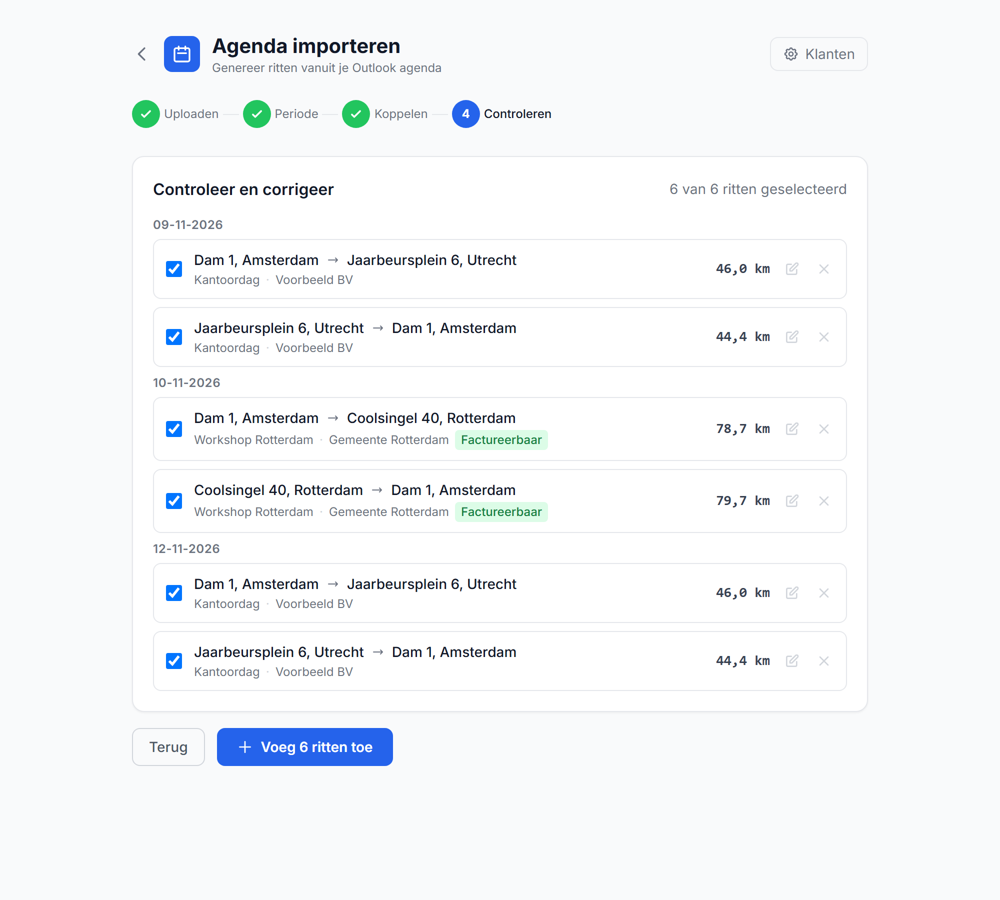

# Kilometer Declaraties

[](https://github.com/Miwat00/km-declaratie/actions/workflows/ci.yml)

Houd je zakelijke kilometers bij en declareer ze in een paar tikken. Vul start- en eindpunt in en de app berekent de rijafstand via OpenStreetMap. Je kunt ook een hele week aan ritten genereren uit je Outlook-agenda.

**[Probeer de live demo →](https://km-declaratie.vercel.app)**

**Privacy:** alles staat lokaal in je browser (localStorage). Er is geen account, geen server en geen tracking.


<p>
  
  &nbsp;
  
</p>

## Features

- **Rit toevoegen** met adres-autocomplete, routekaart en automatische afstand (heen en terug in één keer). De afstand kun je aanpassen (omleiding) of zelf invullen als de routeservice niet bereikbaar is
- **Toegankelijk**: adressen kiezen met pijltjestoetsen en Enter, gekoppelde labels, en vensters die de focus vasthouden
- **Snelknoppen** voor je thuis- en kantooradres
- **Agenda-import** vanuit een `.ics`-export (Outlook, Google Calendar):
  - herkent terugkerende afspraken, verplaatste en geannuleerde afspraken
  - koppelt afspraken aan klanten via zoekwoorden, of aan je kantoor via "kantoor"/"office" in de titel
  - bouwt per dag een ritketen thuis → afspraak → afspraak → thuis
  - zoekt het locatieveld van onbekende afspraken alvast op (Teams/Zoom-links worden overgeslagen)
- **Snelkeuze** voor routes die je vaker rijdt: één tik vult route, doel en klant in
- **Ritten bewerken**: tik op een rit (mobiel) of op het potlood (desktop)
- **Per maand declareren**: filter op maand en status, markeer ritten als gedeclareerd zodat je niets dubbel indient
- **Export** naar CSV (Excel-vriendelijk: `;` en komma-decimalen), PDF (via afdrukken, met handtekeningregel) of direct mailen; op mobiel als bijlage via het deelmenu
- **Tarief per rit**: als je het tarief wijzigt, blijven eerdere ritten op hun oude tarief staan
- **Backup en herstel** als JSON-bestand, ook handig om naar een ander apparaat over te stappen
- **Installeerbaar als app** (PWA) op iOS en Android, en opent ook zonder internet

## Starten

```bash
npm install
npm run dev
```

Open daarna <http://localhost:3000>. Bij de eerste keer vraagt de app om je naam, thuisadres en (optioneel) kantooradres.

| Script | Wat het doet |
| --- | --- |
| `npm run dev` | Ontwikkelserver |
| `npm run build` | Productiebuild |
| `npm test` | Unit tests (Vitest) |
| `npm run e2e` | End-to-end tests (Playwright, desktop + mobiel, met axe-toegankelijkheidscontrole). Eenmalig eerst `npx playwright install chromium` |
| `npm run lint` | ESLint |
| `npm run typecheck` | TypeScript-controle |

## Agenda exporteren

- **Outlook (Windows):** Bestand → Agenda opslaan → kies het datumbereik → `.ics`
- **Google Calendar:** Instellingen → Importeren en exporteren → Exporteren

## Gebruikte diensten

- Geocoding: [Nominatim](https://nominatim.org/) (OpenStreetMap). De app houdt zich aan de [usage policy](https://operations.osmfoundation.org/policies/nominatim/) van maximaal 1 request per seconde. Ga je de app voor veel mensen hosten, gebruik dan een eigen Nominatim-instantie of een commerciële aanbieder.
- Routes: de publieke [OSRM](https://project-osrm.org/)-demoserver. Die is bedoeld voor licht gebruik.
- Kaart: [Leaflet](https://leafletjs.com/) met [OpenStreetMap-tegels](https://operations.osmfoundation.org/policies/tiles/)

Zonder internet kun je ritten bekijken, bewerken en exporteren. Nieuwe routes berekenen en adressen zoeken heeft wel internet nodig.

## Privacy en veiligheid

- **Geen server, geen database.** De app is een statische site. Ritten, adressen en instellingen staan alleen in de browser van wie de app gebruikt. Bezoekers van de demo zien dus nooit elkaars gegevens, en de beheerder ziet ze ook niet.
- **Wat er naar buiten gaat:** adressen die je intypt gaan naar Nominatim (adres zoeken), coördinaten naar OSRM (afstand berekenen) en kaartuitsneden worden bij OpenStreetMap opgehaald. Verder niets.
- **Beveiligingsheaders:** een Content Security Policy staat alleen verbindingen met de app zelf en die drie diensten toe, en de app kan niet in een frame van een andere site worden geladen.
- **Gedeeld apparaat?** Iedereen die die browser gebruikt, kan je ritten zien. Gebruik dan een eigen browserprofiel. "Leeg maken" wist alleen ritten; wil je alles weg (ook naam en adressen), wis dan de sitegegevens in je browserinstellingen.

Screenshots maken met demodata: `npm run build && npx next start -p 3001`, en in een tweede terminal `node scripts/screenshots.mjs`.

## Projectstructuur

```
app/                  pagina's (overzicht en agenda-import)
components/           UI-componenten
components/agenda/    stappen van de agenda-import + useAgendaImport (state en acties)
lib/                  logica zonder UI: .ics-parser, ritten genereren, export, backup, opslag
tests/                unit tests (Vitest)
tests/e2e/            end-to-end tests (Playwright); OSM/OSRM worden daarin nagebootst
```

## Tech stack

Next.js 16 (App Router), React 19, TypeScript, Tailwind CSS, Vitest en Playwright.

## Licentie

[MIT](LICENSE)

---

### English

A small PWA to log business mileage (Dutch UI). It calculates driving distance via OpenStreetMap/OSRM, can generate trips from an `.ics` calendar export, and exports to CSV. All data stays in your browser. Run it with `npm install && npm run dev`.
